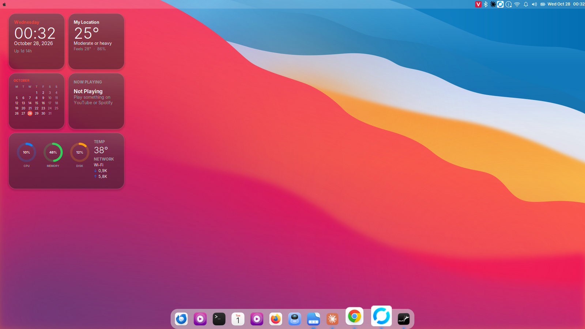
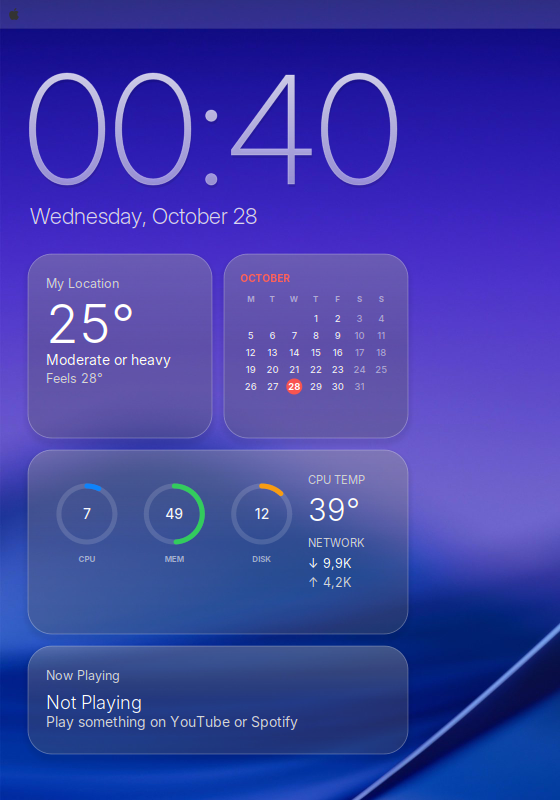
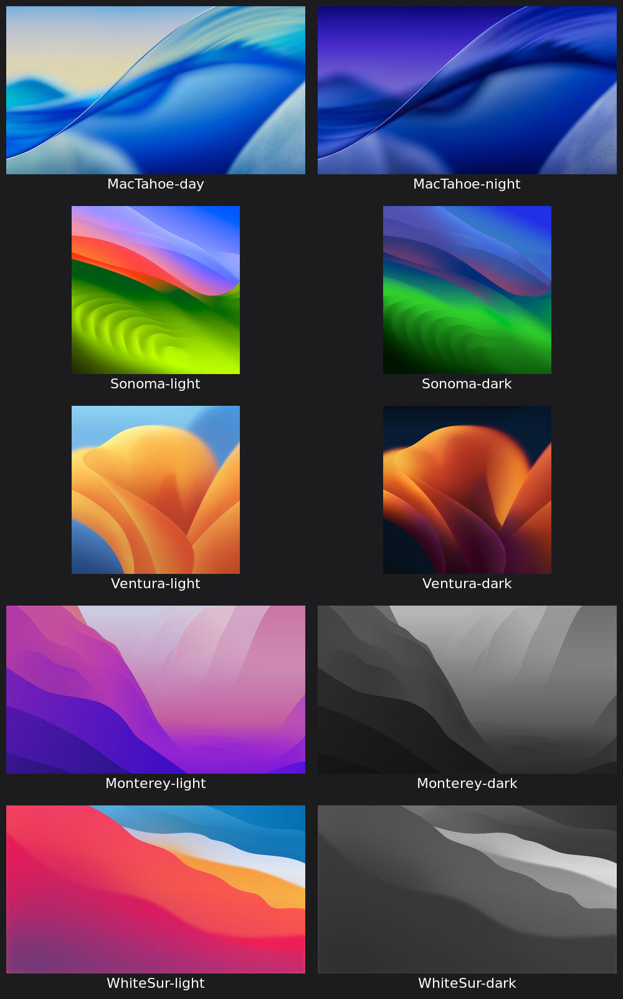

<div align="center">

# mint-mactahoe-vn

**Biến PC Windows cũ thành máy Linux Mint đẹp như macOS 26 Tahoe, chạy nhanh hơn, và sẵn sàng cho AI Agent.**

Một lệnh. Chọn từng phần. Gỡ được. Viết cho người Việt.

[Tiếng Việt](#tiếng-việt) · [English](#english)



</div>

---

## Tiếng Việt

### Repo này khác gì các bản MacTahoe khác?

Hầu hết hướng dẫn "Linux đẹp như Mac" viết cho **Ubuntu GNOME** và chỉ lo phần giao diện. Repo này giải quyết bài toán của một người dùng thật: **PC cũ chạy Windows ì ạch, muốn chuyển sang Linux để làm việc với AI**.

| | Các bản MacTahoe cho GNOME | **mint-mactahoe-vn** |
|---|---|---|
| Hệ điều hành | Ubuntu/Fedora **GNOME 48+** | **Linux Mint XFCE**: nhẹ, quen tay với người từ Windows |
| Máy phù hợp | Máy khá trở lên | **PC cũ, ổ HDD, RAM 4–8GB** vẫn mượt |
| Khám máy trước khi cài | ✗ | ✓ `./install.sh check`: HDD hay SSD, boot mấy giây, dịch vụ nào chậm |
| Widget màn hình | Extension GNOME | ✓ **Đồng hồ lớn trong suốt** và 4 thẻ kính kiểu macOS 26: thời tiết, lịch khoanh đỏ, vòng tròn CPU/RAM, nhạc. Giữ Alt + kéo để di chuyển |
| Hình nền | 1–2 hình | ✓ 10 hình (Tahoe, Sonoma, Ventura, Monterey, Big Sur) và **hình nền động đổi theo giờ** |
| Gõ tiếng Việt | Tuỳ bản | ✓ ibus-bamboo, bấm Super+Space để chuyển |
| Tối ưu PC cũ | ✗ | ✓ preload, tắt dịch vụ thừa (**hỏi từng mục**), Docker chỉ chạy khi cần |
| Remote từ Mac / iPhone | ✗ | ✓ RustDesk + Tailscale, vào máy không cần bấm Accept |
| Máy chạy 24/7 | ✗ | ✓ Chặn sleep, phù hợp chạy n8n, AI agent, bot |
| Môi trường AI Agent | ✗ | ✓ Docker, Node.js LTS, Python, gợi ý Claude Code và n8n |
| Phần mềm văn phòng / đồ hoạ | ✗ | ✓ Bộ open source **ArtCraft**: Photo, Vector, PDF, Word, Grid (thay Photoshop, Illustrator, Acrobat, Word, Excel), có kiểm tra SHA-256 |
| Gỡ cài đặt | Một phần | ✓ Tự **sao lưu trước khi đổi**, `./uninstall.sh` khôi phục |
| Chạy thử | ✗ | ✓ `--dry-run` in ra những gì sẽ làm, không đổi máy |
| Nguồn theme | Đóng gói sẵn (có thể cũ) | **Luôn lấy bản mới nhất** từ repo gốc của vinceliuice |

### Cài nhanh

```bash
git clone https://github.com/tinhphampv-eng/mint-mactahoe-vn.git
cd mint-mactahoe-vn
./install.sh check        # khám máy, không thay đổi gì
./install.sh all          # giao diện + tiếng Việt + tối ưu + chống sleep + remote
```

> Chạy bằng tài khoản thường, **không gõ `sudo` ở đầu lệnh**. Script chỉ hỏi mật khẩu một lần khi cần cài gói.

### Chọn từng phần

| Lệnh | Làm gì |
|---|---|
| `./install.sh check` | Khám máy và gợi ý nâng cấp |
| `./install.sh look` | Trọn bộ giao diện (theme, hình nền, panel, dock, widgets) |
| `./install.sh theme` | Theme MacTahoe, icon, con trỏ, font Inter, hình nền |
| `./install.sh wallpaper` | 10 hình nền macOS và hình nền động (ngày sáng, đêm tối) |
| `./install.sh panel` | Thanh menu trên cùng: logo , khay hệ thống, đồng hồ |
| `./install.sh dock` | Dock Plank ở đáy màn hình, phóng to icon khi rê chuột |
| `./install.sh widgets` | 5 widget kiểu macOS |
| `./install.sh vietnamese` | Bộ gõ tiếng Việt |
| `./install.sh optimize` | Tối ưu PC cũ |
| `./install.sh nosleep` | Không bao giờ sleep |
| `./install.sh remote` | RustDesk + Tailscale |
| `./install.sh ai` | Docker, Node.js, Python cho AI Agent / automation |
| `./install.sh craft` | PhotoCraft, VectorCraft, PdfCraft, WordCraft, GridCraft (bản .deb mới nhất, kiểm tra SHA-256) |
| `./install.sh --dark look` | Dùng bản Tối |
| `./install.sh --dry-run all` | Xem trước, không thay đổi gì |

### Widget



Một **đồng hồ lớn trong suốt** nằm thẳng trên hình nền, bên dưới là các thẻ xếp lưới như macOS 26 (ô nhỏ 180×180, ô rộng 376 px). Mỗi thẻ là kính mờ bo góc 24px, có viền sáng mảnh và bóng đổ rất nhẹ. Chữ dùng font Inter Display mảnh.

| Widget | Hiển thị |
|---|---|
| Big Clock | Giờ cỡ lớn, chữ mảnh trong suốt, kèm thứ và ngày |
| Weather | Nhiệt độ, trạng thái, cảm giác thực (lấy từ wttr.in, không cần API key) |
| Calendar | Lịch tháng kiểu Apple: tên tháng màu đỏ, **khoanh tròn đỏ ngày hôm nay** |
| Now Playing | Bài đang phát trên Spotify, YouTube (Chrome/Firefox), VLC... |
| System | **Vòng tròn CPU, MEM, DISK** như widget Pin của macOS, kèm nhiệt độ CPU và tốc độ mạng |

- **Di chuyển:** giữ **Alt** rồi kéo widget.
- **Đổi thành phố thời tiết:** sửa `~/.config/mint-mactahoe-vn/widgets.env`, ví dụ `MT_WEATHER_LOCATION="Da Nang"`.
- **Bật lại widget:** `~/.config/conky/mint-mactahoe-vn/start.sh`

### Hình nền



10 hình nền do vinceliuice làm: Tahoe, Sonoma, Ventura, Monterey, Big Sur, mỗi bộ có bản sáng và tối. Chọn hình trong **Desktop Settings → Background**.

**Hình nền động:** từ 6:00 đến 18:00 dùng bản sáng, sau đó chuyển sang bản tối, giống Dynamic Wallpaper của macOS. Đổi cặp hình trong `~/.config/mint-mactahoe-vn/wallpaper.env`. Tắt bằng lệnh `systemctl --user disable --now mactahoe-wallpaper.timer`.

### Gỡ cài đặt

```bash
./uninstall.sh                 # khôi phục giao diện từ bản sao lưu gần nhất
```

Các bản sao lưu nằm trong `~/.config/mint-mactahoe-vn/backups/`. Thay đổi hệ thống (preload, dịch vụ, chặn sleep, RustDesk) được giữ nguyên. Lệnh mở lại từng mục được in ra khi gỡ.

### Đã thử trên

- Linux Mint 22.3 XFCE (Xfce 4.18), HP Pavilion 510 · i7-6700T · 16GB RAM · HDD 1TB · GTX 750 Ti

Bạn chạy trên máy khác? Mở [Issue](../../issues) kèm kết quả `./install.sh check` để mình bổ sung.

### Ghi công và giấy phép

Repo này **không chứa lại** theme của người khác. Khi cài, script tải trực tiếp bản mới nhất từ:

- [vinceliuice/MacTahoe-gtk-theme](https://github.com/vinceliuice/MacTahoe-gtk-theme): MIT
- [vinceliuice/MacTahoe-icon-theme](https://github.com/vinceliuice/MacTahoe-icon-theme): GPL-3.0
- [vinceliuice/WhiteSur-cursors](https://github.com/vinceliuice/WhiteSur-cursors): GPL-3.0
- [vinceliuice/WhiteSur-wallpapers](https://github.com/vinceliuice/WhiteSur-wallpapers): MIT
- [storytold/ArtCraft](https://github.com/storytold): PhotoCraft, VectorCraft, PdfCraft, WordCraft, GridCraft (Apache-2.0)
- [BambooEngine/ibus-bamboo](https://github.com/BambooEngine/ibus-bamboo), [RustDesk](https://github.com/rustdesk/rustdesk), [Plank](https://launchpad.net/plank), [Conky](https://github.com/brndnmtthws/conky)

Phần script, cấu hình widget và tài liệu trong repo này dùng giấy phép [MIT](LICENSE). Xem thêm [CREDITS.md](CREDITS.md).

*macOS là nhãn hiệu của Apple Inc. Dự án không liên quan tới Apple.*

---

## English

**Turn an old Windows PC into a Linux Mint XFCE machine that looks like macOS 26 Tahoe, runs faster, and is ready for AI agents.**

Most "make Linux look like a Mac" projects target Ubuntu GNOME and only handle looks. This one is built for **Linux Mint XFCE on old hardware** (HDD, 4–8 GB RAM) and covers the whole switch:

- `check`: hardware report (HDD vs SSD, boot time, slowest services) with upgrade tips, no changes made
- `look`: MacTahoe theme, icons, cursors, 10 macOS wallpapers with a day/night dynamic wallpaper, macOS-style top bar, Plank dock, and 5 macOS 26-style glass widgets (Clock, Weather, Calendar, Now Playing, System rings) you can move with Alt+drag
- `vietnamese`: ibus-bamboo Vietnamese input
- `optimize`: preload, opt-in removal of unneeded services, on-demand Docker
- `nosleep` and `remote`: always-on machine reachable from Mac/iPhone via RustDesk and Tailscale
- `ai`: Docker, Node.js LTS and Python for AI agents and n8n automation
- `craft`: open-source ArtCraft apps (PhotoCraft, VectorCraft, PdfCraft, WordCraft, GridCraft) as replacements for Photoshop, Illustrator, Acrobat, Word and Excel, checksum-verified
- Automatic backup before every change, `./uninstall.sh` to restore, and `--dry-run` to preview

```bash
git clone https://github.com/tinhphampv-eng/mint-mactahoe-vn.git && cd mint-mactahoe-vn
./install.sh check && ./install.sh all
```

Themes are downloaded fresh from the upstream repositories by [vinceliuice](https://github.com/vinceliuice) and are not redistributed here. Scripts in this repo are MIT-licensed.
